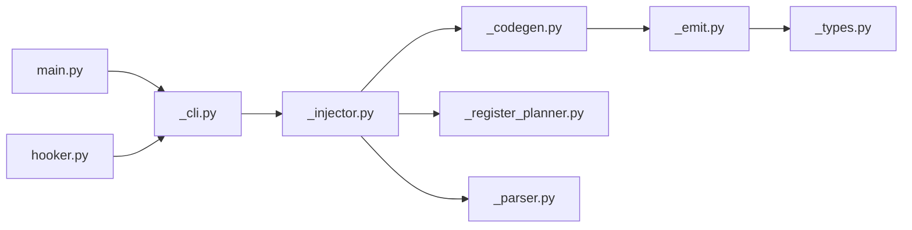

# Estructura

```
src/smalilog/
├── main.py                   # CLI principal (server + menú de hooks)
├── config.py                 # Defaults del servidor y Settings de lms
├── injector/
│   ├── hooker.py             # Fachada pública (re-exporta e inicia run_hooker)
│   ├── _cli.py               # build_hook_parser, run_hooker
│   └── _injector.py          # HookInjector
├── smali/
│   ├── _types.py             # Tipos, parse_type_list, is_reference
│   ├── _model.py             # SmaliMethod, count_parameter_registers, normalize_reg
│   ├── _parser.py            # parse_smali_file, parse_class_name
│   ├── _register_planner.py  # plan_hook_registers
│   ├── _codegen.py           # generate_hook_enter / exit / d_log_level
│   └── _analyze.py           # analyze_method
├── emit/_emit.py             # Helpers de emisión (invoke_static, box_scalar, indent)
├── ui/                       # Color, _c, log_*, resaltado (pygments + fallback)
├── server/logserver.py       # POST /log
└── lms/                      # Experimental (Typer + MCP, carga perezosa)
```

# Estructura interactiva


# Nevo 
Para saver informacion del cache 
> [!NOTE]
> Usar en onCreate() en el princioal invoke-super despues 
- `invoke-static {p0}, Lcom/deadnote/CacheManager;->CacheInfo(Landroid/content/Context;)V`

Para ver la actividad que se ejecuta 
> [!NOTE]
> Va en el mimo lugar que cache
- `invoke-static {p0}, Lcom/deadnote/LifecycleTracker;->init(Landroid/app/Application;)V`

Para detectar errores
> [!NOTE]
> Invocación directa a CrashLogger.init(Context)
`invoke-static {p0}, Lcom/deadnote/CatchError;->init(Landroid/content/Context;)V`

```smali 
.method protected onCreate(Landroid/os/Bundle;)V
    .registers 3

    invoke-super {p0, p1}, Landroidx/appcompat/app/AppCompatActivity;->onCreate(Landroid/os/Bundle;)V

    # Tu llamada inyectada aquí:
    invoke-static {p0}, Lcom/deadnote/CacheManager;->CacheInfo(Landroid/content/Context;)V

    return-void
.end method
```

Como encontra este metodo 

```bash 
apkeditor info -i name.apk
application-class=
```

